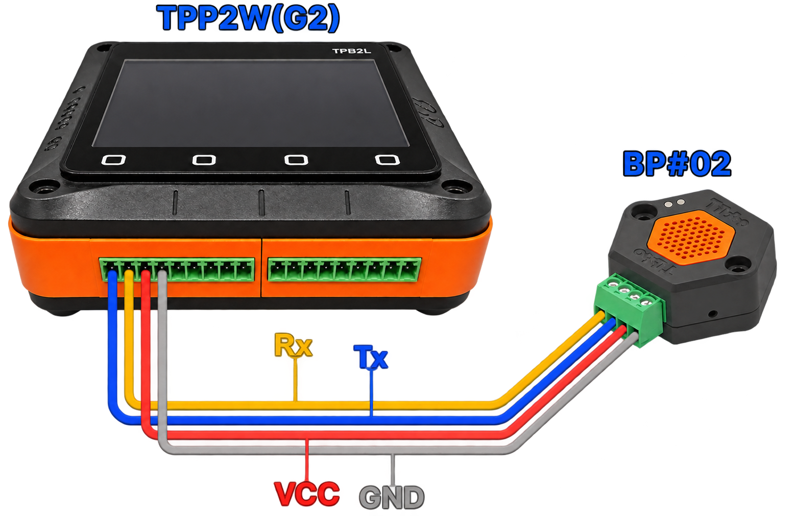
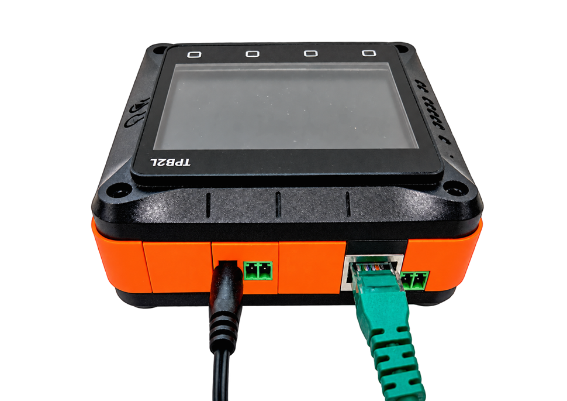

---
> **Firmware:** `bp_modbus_gateway_lcd_v11` v1.0.7  
> **Platform:** Tibbo TPP2W(G2) in a TPB2 enclosure

<br>

---

## Bookmarks

- [1. Overview](#1-overview)
- [2. Hardware and interfaces](#2-hardware-and-interfaces)
- [3. Network configuration and services](#3-network-configuration-and-services)
- [4. Device Console](#4-device-console)
  - [4.1 General](#41-general)
  - [4.2 Wi-Fi](#42-wi-fi)
  - [4.3 Modbus channels](#43-modbus-channels)
  - [4.4 Reboot and initialize settings](#44-reboot-and-initialize-settings)
- [5. Deployment example](#5-deployment-example)
  - [5.1 Connect the Modbus RTU devices](#51-connect-the-modbus-rtu-devices)
  - [5.2 Connect the network and power](#52-connect-the-network-and-power)
  - [5.3 Find the device and open the Device Console](#53-find-the-device-and-open-the-device-console)
  - [5.4 Configure a channel](#54-configure-a-channel)
  - [5.5 Test Modbus TCP to Modbus RTU forwarding](#55-test-modbus-tcp-to-modbus-rtu-forwarding)
- [6. Commissioning checklist](#6-commissioning-checklist)
- [7. Troubleshooting](#7-troubleshooting)

<br><br>

---

<a id="1-overview"></a>
## 1. Overview [↑](#bookmarks "Back to Bookmarks")

The Tibbo Modbus Gateway connects a Modbus TCP client on an Ethernet or Wi-Fi
network to up to four independent Modbus RTU buses. It is intended for systems
where a SCADA system, PLC, HMI, or other Modbus TCP master must communicate
with serial Modbus field devices.

Each TCP listening port is assigned to one RTU channel. When a Modbus TCP
client sends a request to a channel's port, the gateway forwards the request
to the associated RS-485 bus using the original Modbus unit ID. The reply from
the RTU device is returned to the TCP client.


The gateway forwards the following Modbus functions:

| Function code | Function |
| --- | --- |
| `01` | Read Coils |
| `02` | Read Discrete Inputs |
| `03` | Read Holding Registers |
| `04` | Read Input Registers |
| `05` | Write Single Coil |
| `06` | Write Single Register |
| `10` | Write Multiple Registers |

> **IMPORTANT:** A Modbus write sent through the gateway changes the connected
> field device. Enable and use write functions only for approved control points
> and only when it is safe to change the device state.

<br><br>

---

<a id="2-hardware-and-interfaces"></a>
## 2. Hardware and interfaces [↑](#bookmarks "Back to Bookmarks")

| Item | Detail |
| --- | --- |
| Controller | Tibbo TPP2W(G2) Tibbo Project PCB |
| Network | On-board 10/100 Base-T Ethernet with RJ45 |
| Wireless network | WA2000 Wi-Fi module |
| Field interfaces | Four Tibbit #05 RS-485 ports in sockets 1, 3, 5, and 7 |
| Display | 320 × 240 LCD showing network and channel status |
| Status indication | On-board red/green LEDs and LCD channel indicators |
| MD button | Provides an audible indication when pressed; it does not reset settings in this firmware |
| RST button | Restarts the device |

<br>

> **NOTE:** Install the required Tibbit #05 RS-485 interfaces before powering
> the device. Follow the connected field device's documentation for RS-485
> wiring, polarity, termination, biasing, power, and serial parameters.

<br><br>

---

<a id="3-network-configuration-and-services"></a>
## 3. Network configuration and services [↑](#bookmarks "Back to Bookmarks")

| Service | Setting |
| --- | --- |
| Ethernet | DHCP disabled by default; static IPv4 configuration is active |
| Wi-Fi | Station mode with DHCP enabled by default; configure an SSID and password before use |
| Device Console | HTTP on port `80` |
| Modbus TCP | Four configurable TCP listening ports; default ports `502` to `505` |
| Time synchronization | SNTP against `216.239.35.0` (`time.google.com`) when the device has network access |

> **NOTE:**
> - Out of the box, Ethernet DHCP is **disabled** and the device uses the
>   **default** static IP address `192.168.1.40`. This placeholder makes the
>   device reachable on first power-up; change it to match your network.
> - When Ethernet DHCP is enabled, use the address assigned by your DHCP server
>   instead.
> - Wi-Fi is enabled in **Station** mode with DHCP enabled, but is not
>   configured to join a network until you enter its SSID and password.
> - A **network connection** is required for Device Console access, Modbus TCP
>   communication, and time synchronization.

<br><br>

---

<a id="4-device-console"></a>
## 4. Device Console [↑](#bookmarks "Back to Bookmarks")

The browser-based configuration interface is called the **Device Console**.
Open `http://<device-ip>` in a supported web browser.

> **Reminder:** Restart the device after changing network, port, or RTU
> settings. This ensures that the network services and Modbus channels start
> with the new configuration.

<a id="41-general"></a>
### 4.1 General [↑](#bookmarks "Back to Bookmarks")

Use the **General** group to configure the Ethernet connection and device
identity.

| Setting | Meaning |
| --- | --- |
| Ethernet DHCP | Enables or disables DHCP for Ethernet. |
| Ethernet IP | Static IPv4 address used when Ethernet DHCP is disabled. |
| Ethernet Netmask | Netmask for the static Ethernet address. |
| Ethernet Gateway | Default gateway for the static Ethernet address. |
| Device Name | Optional device name displayed by the Device Console. |
| Owner Name | Optional owner identifier. |

> **NOTE:** Changing network settings can interrupt the current Device Console
> session. If you assign a new static address, reconnect using that address
> after the device restarts.

<a id="42-wi-fi"></a>
### 4.2 Wi-Fi [↑](#bookmarks "Back to Bookmarks")

Use the **Wi-Fi** group to connect the gateway to a wireless network.

| Setting | Meaning |
| --- | --- |
| Wifi AP SSID | Name of the wireless access point. |
| Wifi Security | Security mode used by the access point. |
| Wifi Password | Wi-Fi password or passphrase. |
| Wifi DHCP | Enables or disables DHCP for Wi-Fi. |
| Wifi IP, Netmask, Gateway | Static IPv4 settings used when Wi-Fi DHCP is disabled. |

> **NOTE:** Wi-Fi is enabled in **Station** mode with DHCP enabled by default,
> but it is not configured to join a network: the default SSID and password
> are blank. Its displayed static IP address and gateway placeholders are both
> `1.0.0.1`. Enter the SSID and password supplied by the network administrator,
> then restart the device and confirm its IP address on the LCD.

<a id="43-modbus-channels"></a>
### 4.3 Modbus channels [↑](#bookmarks "Back to Bookmarks")

The Device Console has one configuration group for each channel: **CH1**,
**CH2**, **CH3**, and **CH4**.

| Channel | Default TCP listening port | Tibbit #05 socket | Default RTU baud rate |
| --- | ---: | ---: | ---: |
| CH1 | `502` | 1 | 38,400 bps |
| CH2 | `503` | 3 | 38,400 bps |
| CH3 | `504` | 5 | 38,400 bps |
| CH4 | `505` | 7 | 38,400 bps |

For each channel, configure:

| Setting | Meaning |
| --- | --- |
| Listening Port | TCP port on which the gateway accepts Modbus TCP requests for that channel. |
| Tibbit 05 Baud Rate | RS-485 bit rate. Select the rate used by the connected RTU devices. |
| Tibbit 05 Flow Control | Presented in the Device Console. |
| Tibbit 05 Parity | Presented in the Device Console. |
| Tibbit 05 Data Bits | Presented in the Device Console. |

> **IMPORTANT — current firmware limitation:** Firmware v1.0.7 applies the
> selected **baud rate** when it starts each RTU channel. Although the console
> also displays flow-control, parity, and data-bit fields, this firmware does
> not apply those fields to the active serial interface; RTU operation uses
> no parity. Match the connected devices accordingly.

> **NOTE:** A channel accepts Modbus TCP requests only on its configured
> listening port. The TCP port identifies the RTU bus; the Modbus **unit ID**
> in each request identifies the field device on that bus.

<a id="44-reboot-and-initialize-settings"></a>
### 4.4 Reboot and initialize settings [↑](#bookmarks "Back to Bookmarks")

Use the Device Console system controls to restart the device or initialize its
stored settings. These operations require administrator access.

- **Reboot:** Restarts the gateway and applies the stored network and channel
  configuration.
- **Initialize Settings:** Restores the application settings to their default
  values. Reboot the device afterward.

> **NOTE:** The on-board MD button is not a factory-reset control in this
> firmware. Use **Initialize Settings** in the Device Console when a settings
> reset is required.

<br><br>

---

<a id="5-deployment-example"></a>
## 5. Deployment example [↑](#bookmarks "Back to Bookmarks")

This example configures CH1 so that a Modbus TCP client can reach a Modbus RTU
device on the RS-485 bus in Tibbit socket 1.

<a id="51-connect-the-modbus-rtu-devices"></a>
### 5.1 Connect the Modbus RTU devices [↑](#bookmarks "Back to Bookmarks")

Before wiring, disconnect power from the gateway and the field device.
Connect the RS-485 A/B lines from the field device to the Tibbit #05 installed
in socket 1. If additional buses are required, use sockets 3, 5, and 7 for
CH2, CH3, and CH4 respectively.

Confirm the following with the field-device documentation:

- RS-485 A/B polarity and any signal ground requirement.
- Modbus RTU baud rate and no-parity serial format.
- Modbus unit ID of every device on the bus.
- Required termination and biasing for the bus topology.

> **IMPORTANT:** Do not connect two devices with the same Modbus unit ID to
> the same RTU bus.



<a id="52-connect-the-network-and-power"></a>
### 5.2 Connect the network and power [↑](#bookmarks "Back to Bookmarks")

Connect the RJ45 Ethernet port to the local network, or prepare the Wi-Fi
network details. Then connect power to the gateway and allow it to boot.

Ethernet DHCP is disabled by default, so connect using the configured static
IP address. When DHCP is enabled, obtain the assigned address from the DHCP
server or read it from the LCD instead.



<a id="53-find-the-device-and-open-the-device-console"></a>
### 5.3 Find the device and open the Device Console [↑](#bookmarks "Back to Bookmarks")

In a web browser, enter:

```text
http://<device-ip>
```

For example, when static Ethernet is configured with the factory default
address:

```text
http://192.168.1.40
```

Sign in with credentials authorized for device administration before changing
settings.

<a id="54-configure-a-channel"></a>
### 5.4 Configure a channel [↑](#bookmarks "Back to Bookmarks")

For a device wired to socket 1:

1. Open the **CH1** group in the Device Console.
2. Set **Channel 1 Listening Port**. Use `502` unless your network requires a
   different port.
3. Set **Tibbit 05 Baud Rate** to the baud rate used by the field device.
4. Confirm that the field device uses no parity, as required by this firmware.
5. Save the settings and restart the gateway.
6. After the reboot, confirm that the gateway is reachable at its configured
   network address.

Repeat these steps for CH2, CH3, and CH4 as needed. Use a different TCP port
for each enabled channel.

<a id="55-test-modbus-tcp-to-modbus-rtu-forwarding"></a>
### 5.5 Test Modbus TCP to Modbus RTU forwarding [↑](#bookmarks "Back to Bookmarks")

Configure your Modbus TCP client with the gateway's IP address and the port of
the required channel. For CH1, use port `502`. Set the client unit ID to the
Modbus address of the RTU field device.

For example, read one holding register at address `0` from unit ID `1` through
CH1. The exact client command depends on the Modbus tool in use; configure it
with these values:

| Client setting | Example value |
| --- | --- |
| Protocol | Modbus TCP |
| Gateway IP address | `<device-ip>` |
| TCP port | `502` |
| Unit ID | `1` |
| Function | Read Holding Registers (`03`) |
| Start address | `0` |
| Quantity | `1` |

Confirm that the returned value matches the field device. The LCD indicates
client connections and recent data activity for each channel.

> **NOTE:** Register numbering varies by Modbus device and client software.
> Enter the address format required by the client and verify it against the
> field device's register map.

<br><br>

---

<a id="6-commissioning-checklist"></a>
## 6. Commissioning checklist [↑](#bookmarks "Back to Bookmarks")

1. Install Tibbit #05 RS-485 interfaces in the required sockets.
2. Wire the RS-485 buses and check polarity, termination, and biasing.
3. Confirm the unit ID and serial baud rate of every RTU field device.
4. Connect Ethernet and power the gateway, then obtain its IP address from the
   LCD or DHCP server.
5. Open the Device Console at `http://<device-ip>`.
6. Configure Ethernet or Wi-Fi settings as required by the installation.
7. Configure each required channel's unique TCP listening port and RTU baud
   rate.
8. Restart the gateway.
9. Configure the Modbus TCP client with the gateway IP address, channel port,
   and RTU device unit ID.
10. Read a known register from each RTU device.
11. Where safe, test the required write functions and verify the change at the
    field device.

<br><br>

---

<a id="7-troubleshooting"></a>
## 7. Troubleshooting [↑](#bookmarks "Back to Bookmarks")

| Symptom | Checks |
| --- | --- |
| Cannot open the Device Console | Confirm the gateway IP address on the LCD or DHCP server, verify network reachability, and use HTTP port `80`. |
| No Ethernet address is assigned | Check the Ethernet cable, switch port, and DHCP-server availability. If DHCP is disabled, verify the static IP, netmask, and gateway. |
| Wi-Fi does not connect | Verify the SSID, password, security mode, signal coverage, and DHCP or static IPv4 settings. Restart after changing Wi-Fi settings. |
| Modbus TCP client cannot connect | Verify the gateway IP address, selected TCP port, firewall rules, and that the listening port is not duplicated by another channel. |
| Modbus TCP request times out | Check RS-485 wiring and polarity, RTU baud rate, field-device power, unit ID, termination/biasing, and the selected channel/socket. |
| Gateway returns a target-device failure exception | The RTU device did not reply before the gateway timeout. Check the serial bus and field-device configuration. |
| Gateway returns a busy exception | Reduce request rate or retry the request. The gateway has a limited queue for pending TCP-to-RTU transactions. |
| Read value is incorrect | Verify the function code, register address convention, unit ID, data type, scaling, and byte/word order in the field-device register map. |
| Device requires parity or a different data-bit format | Firmware v1.0.7 operates its RTU channels with no parity. Use compatible field-device serial settings or obtain firmware that applies the required format. |
| Changed configuration does not take effect | Save the settings, then restart the gateway. |
| MD button does not reset settings | This firmware assigns an audible indication to the MD button. Use the Device Console's **Initialize Settings** control instead. |
