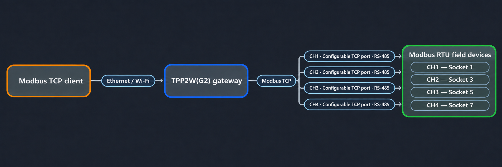
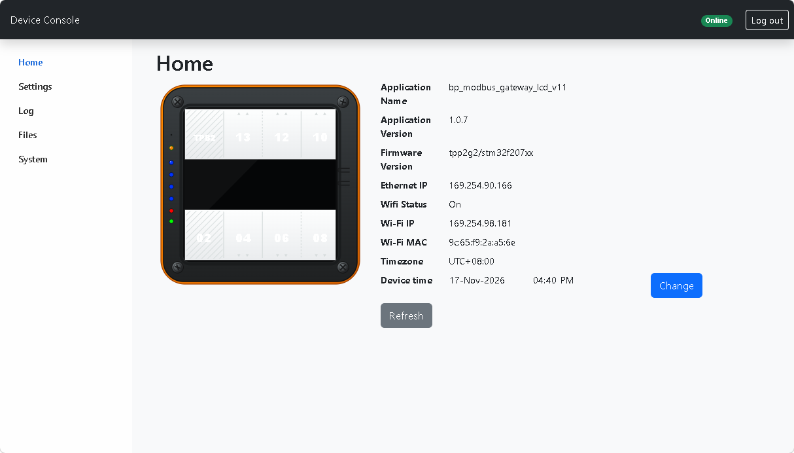
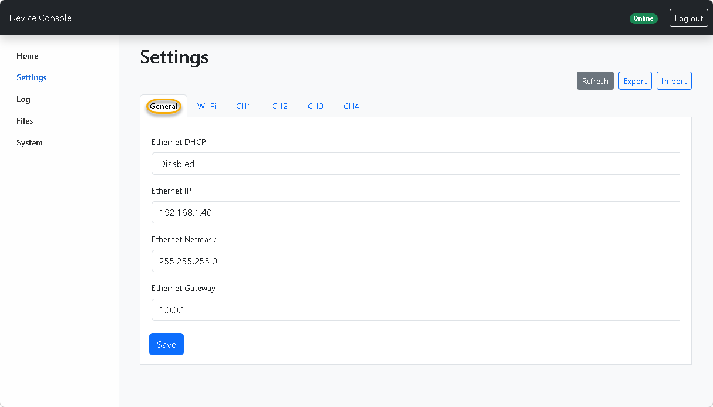
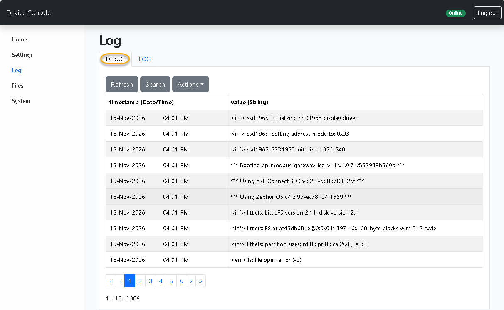
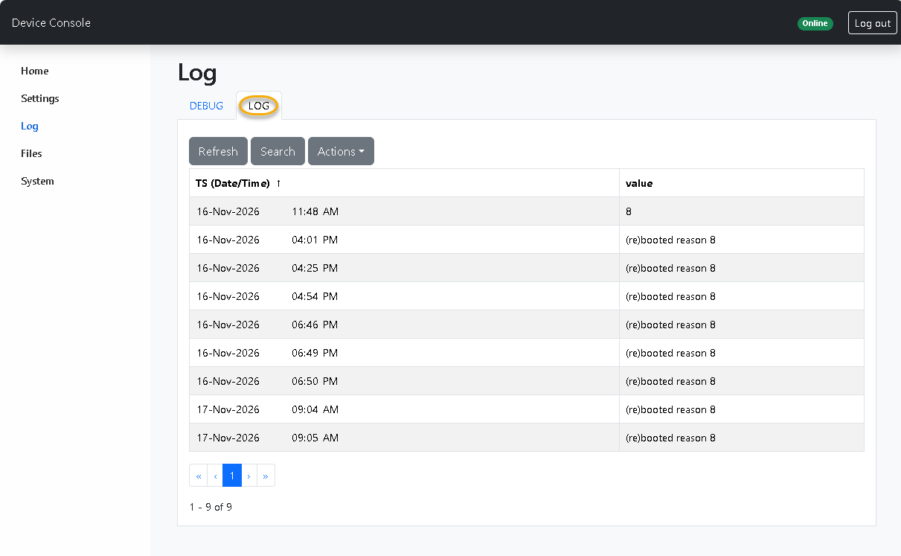
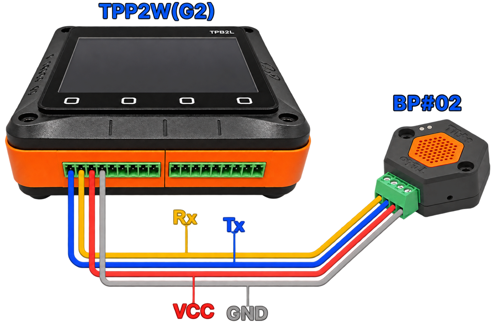

---
> **Firmware:** `bp_modbus_gateway_lcd_v11` v1.0.7  
> **Platform:** Tibbo TPP2W(G2) in a TPB2L(G2) enclosure

 

---

## Bookmarks

- [1. Overview](#1-overview)
- [2. Hardware and interfaces](#2-hardware-and-interfaces)
- [3. Network configuration and services](#3-network-configuration-and-services)
- [4. Device Console](#4-device-console)
  - [4.1 Home](#41-home)
  - [4.2 Settings](#42-settings)
    - [4.2.1 General](#421-general)
    - [4.2.2 Wi-Fi](#422-wi-fi)
    - [4.2.3 Modbus channels](#423-modbus-channels)
  - [4.3 Log](#43-log)
    - [4.3.1 Debug](#431-debug)
    - [4.3.2 Log](#432-log)
  - [4.4 System](#44-system)
    - [4.4.1 Commands](#441-commands)
    - [4.4.2 Time](#442-time)
- [5. Deployment example](#5-deployment-example)
  - [5.1 Connect the Modbus RTU devices](#51-connect-the-modbus-rtu-devices)
  - [5.2 Connect the network and power](#52-connect-the-network-and-power)
  - [5.3 Connect to the Device Console](#53-connect-to-the-device-console)
  - [5.4 Configure General](#54-configure-network-in-general)
  - [5.5 Configure Wi-Fi](#55-configure-wi-fi)
  - [5.6 Configure Channels](#56-configure-channels)
  - [5.7 Download TCP-to-Modbus Test Software](#57-download-tcp-to-modbus-test-software)
  - [5.8 Configure Test Software](#58-configure-test-software)
  - [5.9 Start Test Software](#59-start-test-software)
  - [5.10 Check Result In Test Software](#510-check-result-in-test-software)
- [6. Commissioning checklist](#6-commissioning-checklist)
- [7. Troubleshooting](#7-troubleshooting)

  

---

## 1. Overview [↑](#bookmarks "Back to Bookmarks")

The Tibbo Modbus Gateway connects a Modbus TCP client on an Ethernet or Wi-Fi
network to up to four independent Modbus RTU buses. It is intended for systems
where a SCADA system, PLC, HMI, or other Modbus TCP master must communicate
with serial Modbus field devices. It operates as a **Modbus TCP-to-RTU
pass-through gateway**.

Each TCP listening port is assigned to one RTU channel. When a Modbus TCP
client sends a request to a channel's port, the gateway forwards the request
to the associated RS-485 bus using the original Modbus unit ID. The reply from
the RTU device is returned to the TCP client. The gateway does not
independently poll field devices, store register values, or initiate Modbus
requests without a request from a Modbus TCP client.

---

## 2. Hardware and interfaces [↑](#bookmarks "Back to Bookmarks")

| Item | Detail |
| --- | --- |
| Controller | Tibbo TPP2W(G2) Tibbo Project PCB |
| Enclosure | TPB2L(G2), DIN-rail mounting kit, vibration-proof kit |
| Network | On-board 10/100 Base-T Ethernet with RJ45 |
| Wireless network | WA2000 Wi-Fi module |
| Field interfaces | Four Tibbit #05 RS-485 ports in sockets 1, 3, 5, and 7 |
| Field connector | 2× Tibbit #20 (9-terminal block) |
| Power | Tibbit #10 power supply module in socket 11 |
| Power adapter | APR-P0008 adapter |
| Storage | 1 MB AT45DB081E dataflash, LittleFS file system |
| Display | 320 × 240 LCD showing network and channel status |
| Status LEDs | On-board red/green LEDs and LCD channel indicators |
| MD button | Provides an audible indication when pressed; it does not reset settings in this firmware |
| RST button | Restarts the device |

  

---

## 3. Network configuration and services [↑](#bookmarks "Back to Bookmarks")

| Service | Setting |
| --- | --- |
| Ethernet | static IP/netmask/gateway, or DHCP  |
| Wi-Fi | Station mode; DHCP or static IP/netmask/gateway; SSID, security type, and password |
| Device Console | HTTP on port `80` |
| Modbus TCP | Four configurable TCP listening ports; default ports `502`, `503`, `504`,`505` |
| Time sync | SNTP against 216.239.35.0 (time.google.com), applied with the configured time zone |
| Device Console | HTTP, port 80, 3 concurrent connections |

 

> **Ethernet:**
> - Out of the box, Ethernet DHCP is **disabled** and the device uses the
>   **default** static IP address `192.168.1.40`. This placeholder makes the
>   device reachable on first power-up; change it to match your network.
> - When Ethernet DHCP is enabled, use the address assigned by your DHCP server
>   instead.

> **Wi-Fi:**
> - Wi-Fi is enabled in **Station** mode with DHCP enabled, but is not
>   configured to join a network until you enter its SSID and password.
> - A **network connection** is required for Device Console access, Modbus TCP
>   communication, and time synchronization.

  

---

## 4. Device Console [↑](#bookmarks "Back to Bookmarks")

The browser-based configuration interface is called the **Device Console**.
Open `http://<device-ip>` in a supported web browser.

> **NOTE:**
> The browser-based configuration interface is called the **Device Console**. It
> may also be referred to as the Web Console in AppBlocks documentation.

 

### 4.1 Home [↑](#bookmarks "Back to Bookmarks")

On the **Home** page, general gateway information is displayed.

> **NOTE:**
> - Select **Refresh** to update the displayed information.
> - Use **Change** to adjust the displayed device time settings when required.

 

### 4.2 Settings [↑](#bookmarks "Back to Bookmarks")

The **Settings** tab contains the General, Wi-Fi, Modbus channel, and system
configuration groups.

#### 4.2.1 General [↑](#bookmarks "Back to Bookmarks")

In the **General** group, DHCP can be enabled or a static Ethernet IP address,
netmask, and gateway can be configured.

> **NOTE:**
> - When DHCP is enabled, the static Ethernet address fields are **Unavailable**.
> - DHCP may assign a different IP address and interrupt your Device Console connection.
> - To keep the device reachable at a known address, a **static** IP address is recommended.

#### 4.2.2 Wi-Fi [↑](#bookmarks "Back to Bookmarks")

Wi-Fi is available on the `TCP Modbus Gateway`. To connect to an existing
wireless network, the correct SSID, security type, and password must be
provided.

> **NOTE:**
> DHCP can be used, or a static IP address, netmask, and gateway can be configured.

#### 4.2.3 Modbus channels [↑](#bookmarks "Back to Bookmarks")

The Device Console has one configuration group for each channel: **CH1**,
**CH2**, **CH3**, and **CH4**.

The **CH1** configuration group is shown below.

> **NOTE:**
> - Channels **CH2**, **CH3**, and **CH4** are configured in the same way, each with its own listening port and RTU settings.
> - All four channels can be configured to meet the requirements of the installation.

 

### 4.3 Log [↑](#bookmarks "Back to Bookmarks")

On the Log page, device log messages stored in Flash are shown in the following groups:

- Debug
- Log

> **NOTE:** For each group, the entries show a timestamp and recorded value.

#### 4.3.1 Debug [↑](#bookmarks "Back to Bookmarks")

#### 4.3.2 Log [↑](#bookmarks "Back to Bookmarks")

### 4.4 System [↑](#bookmarks "Back to Bookmarks")

The **System** tab contains the **Commands** and **Time** groups.

#### 4.4.1 Commands [↑](#bookmarks "Back to Bookmarks")

Let's take a look at the **Commands** group first. It provides controls to
restart the device or initialize its stored settings.

- **Reboot:** Restarts the gateway and applies the stored network and channel
  configuration.
- **Initialize Settings:** Restores the application settings to their default
  values. **A reboot is Required**.

#### 4.4.2 Time [↑](#bookmarks "Back to Bookmarks")

The **Time** group shows the device time, time zone, daylight-saving status,
and last SNTP synchronization time.

The following controls are available:

- **Change:** Sets the device time manually.
- **Set to This Computer's Time:** Sets the device time from the computer
  running the Device Console.
- **Sync with SNTP Server:** Synchronizes the device time with the configured
  SNTP server.

> **NOTE:** If Sync with SNTP Server does not succeed, check the device’s network connection and make sure it has internet access.

  

---

## 5. Deployment example [↑](#bookmarks "Back to Bookmarks")

This example configures CH1 so that a Modbus TCP client can reach a Modbus RTU
device on the RS-485 bus in Tibbit socket 1.

### 5.1 Connect the Modbus RTU devices [↑](#bookmarks "Back to Bookmarks")

The deployment steps use a Tibbo Modbus BP#02, a sensor for ambient
temperature and relative humidity. The BP#02 is used only as an example;
another compatible Modbus device can be connected instead.

> **IMPORTANT:** Before replacing a Modbus sensor or changing its wiring,
> disconnect power from the device. Reconnect power only after the new sensor
> and all wiring have been connected correctly.

Connect the BP#02 to the TPP2W(G2) as shown below. Connect each wire to the
terminal with the matching label: `VCC` to `VCC`, `GND` to `GND`, `Tx` to
`Tx`, and `Rx` to `Rx`. When using a different Modbus device, follow its
documentation for the required power and communication connections.

> **TIP:** More Tibbo RS-485 Modbus sensor models are available [here](https://tibbo.com/store/rs485-modbus-sensors.html).

 

### 5.2 Connect the network and power [↑](#bookmarks "Back to Bookmarks")

Connect an Ethernet cable from the device's RJ45 port to your local network.
Then connect the supplied power adapter to the device. The device starts when
power is connected. Allow up to 20 seconds for the device to fully boot and
become ready for use.

 

### 5.3 Connect to the Device Console [↑](#bookmarks "Back to Bookmarks")

Using your preferred web browser, navigate to [http://192.168.1.40](http://192.168.1.40). Shortly after, the **Home** page should be displayed (see [Section 4.1](#41-home)).

 

### 5.4 Configure General [↑](#bookmarks "Back to Bookmarks")

The Ethernet connection for the local network is configured in the
**General** group.

> **NOTE:**
> - This example uses the default Ethernet configuration.
> - If changes are required, see [Section 4.2.1](#421-general).

 

### 5.5 Configure Wi-Fi [↑](#bookmarks "Back to Bookmarks")

In the **Wi-Fi** group, configure the wireless connection as required for the
installation.

> **NOTE:**
> - This Ethernet-based example leaves the default Wi-Fi configuration unchanged.
> - If changes are required, see [Section 4.2.2](#422-wi-fi).

 

### 5.6 Configure Channels [↑](#bookmarks "Back to Bookmarks")

Configure the required Modbus TCP-to-RTU channels for the installation.

> **NOTE:**
> - This example uses the default channel configuration.
> - If changes are required, see [Section 4.2.3](#423-modbus-channels).

 

### 5.7 Download TCP-to-Modbus Test Software [↑](#bookmarks "Back to Bookmarks")

Download and install the TCP-to-Modbus test software before continuing.

The gateway forwards the following Modbus functions between the channel's TCP
listening port and associated RS-485 bus:

| Function code | Function |
| :------------ | :----------------------- |
| `01` | Read Coils |
| `02` | Read Discrete Inputs |
| `03` | Read Holding Registers |
| `04` | Read Input Registers |
| `05` | Write Single Coil |
| `06` | Write Single Register |
| `10` | Write Multiple Registers |

> **IMPORTANT:** A Modbus write sent through the gateway changes the connected
> field device. Enable and use write functions only for approved control points
> and only when it is safe to change the device state.

 

### 5.8 Configure Test Software [↑](#bookmarks "Back to Bookmarks")

Configure the test software with the gateway's IP address, the TCP listening
port for the required channel, and the Modbus unit ID of the RTU field device.
For CH1, use port `502`.

 

### 5.9 Start Test Software [↑](#bookmarks "Back to Bookmarks")

Start the test software and connect to the configured gateway IP address and
TCP port.

 

### 5.10 Check Result In Test Software [↑](#bookmarks "Back to Bookmarks")

For example, read one holding register at address `0` from unit ID `1` through
CH1. The exact client command depends on the Modbus tool in use; configure it
with these values:

| Client setting | Example value |
| --- | --- |
| Protocol | Modbus TCP |
| Gateway IP address | `<device-ip>` |
| TCP port | `502` |
| Unit ID | `1` |
| Function | Read Holding Registers (`03`) |
| Start address | `0` |
| Quantity | `1` |

Confirm that the returned value matches the field device. The LCD indicates
client connections and recent data activity for each channel.

> **NOTE:** Register numbering varies by Modbus device and client software.
> Enter the address format required by the client and verify it against the
> field device's register map.

  

---

## 6. Commissioning checklist [↑](#bookmarks "Back to Bookmarks")

1. Install Tibbit #05 RS-485 interfaces in the required sockets.
2. Wire the RS-485 buses and check polarity, termination, and biasing.
3. Confirm the unit ID and serial baud rate of every RTU field device.
4. Connect Ethernet and power the gateway, then obtain its IP address from the
   LCD or DHCP server.
5. Open the Device Console at `http://<device-ip>`.
6. Configure Ethernet or Wi-Fi settings as required by the installation.
7. Configure each required channel's unique TCP listening port and RTU baud
   rate.
8. Restart the gateway.
9. Configure the Modbus TCP client with the gateway IP address, channel port,
   and RTU device unit ID.
10. Read a known register from each RTU device.
11. Where safe, test the required write functions and verify the change at the
    field device.

  

---

## 7. Troubleshooting [↑](#bookmarks "Back to Bookmarks")

| Symptom | Checks |
| --- | --- |
| Cannot open the Device Console | Confirm the gateway IP address on the LCD or DHCP server, verify network reachability, and use HTTP port `80`. |
| No Ethernet address is assigned | Check the Ethernet cable, switch port, and DHCP-server availability. If DHCP is disabled, verify the static IP, netmask, and gateway. |
| Wi-Fi does not connect | Verify the SSID, password, security mode, signal coverage, and DHCP or static IPv4 settings. Restart after changing Wi-Fi settings. |
| Modbus TCP client cannot connect | Verify the gateway IP address, selected TCP port, firewall rules, and that the listening port is not duplicated by another channel. |
| Modbus TCP request times out | Check RS-485 wiring and polarity, RTU baud rate, field-device power, unit ID, termination/biasing, and the selected channel/socket. |
| Gateway returns a target-device failure exception | The RTU device did not reply before the gateway timeout. Check the serial bus and field-device configuration. |
| Gateway returns a busy exception | Reduce request rate or retry the request. The gateway has a limited queue for pending TCP-to-RTU transactions. |
| Read value is incorrect | Verify the function code, register address convention, unit ID, data type, scaling, and byte/word order in the field-device register map. |
| Device requires parity or a different data-bit format | Firmware v1.0.7 operates its RTU channels with no parity. Use compatible field-device serial settings or obtain firmware that applies the required format. |
| Changed configuration does not take effect | Save the settings, then restart the gateway. |
| MD button does not reset settings | This firmware assigns an audible indication to the MD button. Use the Device Console's **Initialize Settings** control instead. |
